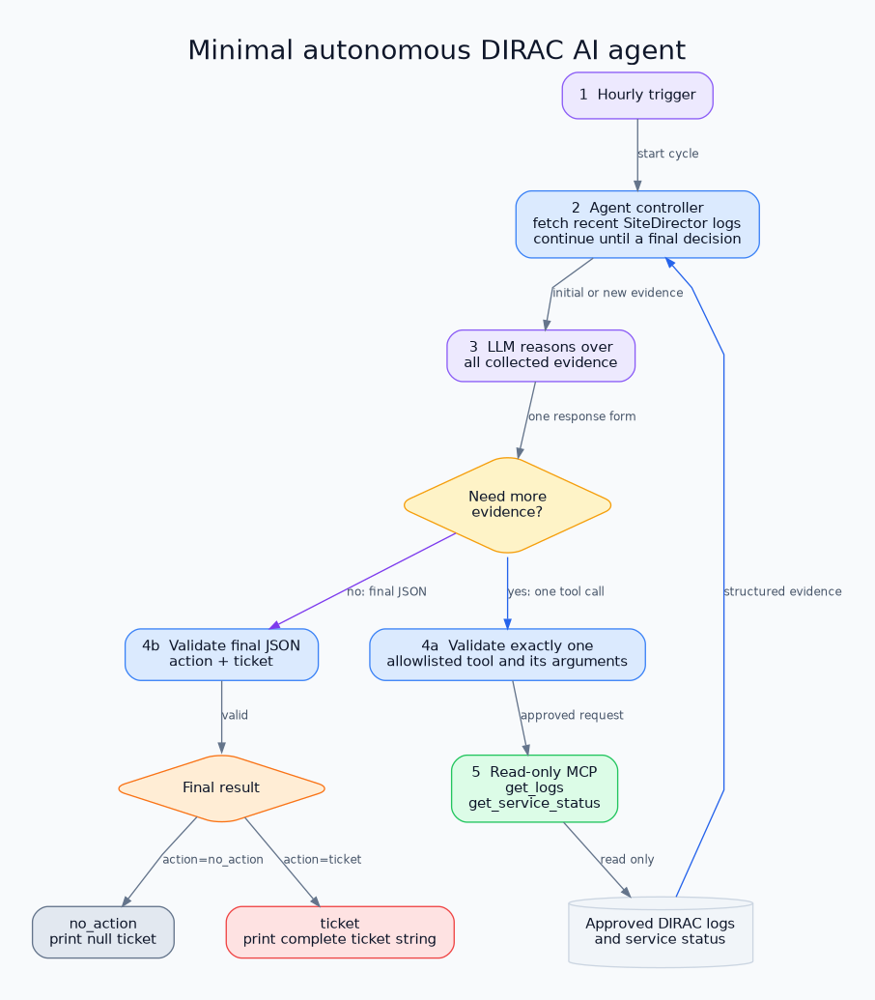

# Minimal DIRAC AI Agent Prototype

This first prototype runs automatically once per hour. It reads recent
SiteDirector logs, lets an LLM request additional read-only evidence when
needed, and prints exactly one result:

```json
{"action": "ticket", "ticket": "Subject: ...\n\nEvidence and requested action..."}
```

or:

```json
{"action": "no_action", "ticket": null}
```



## What is included

- `agent.py`: hourly loop, LLM reasoning loop, tool-call validation, and final
  decision validation.
- `mcp_server.py`: only two read-only tools:
  - `get_logs(source, lines, contains)`
  - `get_service_status(service)`
- `sample_data/`: deterministic data for local testing.
- `tests/`: no-network tests using a scripted fake model and in-memory MCP.
- `architecture.dot` and `architecture.png`: editable and rendered diagram.

There is deliberately no state database, cursor file, ticket store,
deduplication, shell tool, service restart, external ticket submission, or
deployment configuration. The result is printed to standard output. Because
the prototype stores no state, it may inspect the same recent lines again in a
later cycle or after a restart.

## Decision loop

```text
hourly trigger
  -> fetch recent SiteDirector logs through MCP
  -> ask the LLM to reason over the evidence
  -> optionally call one read-only MCP tool per turn
  -> return to the LLM with the tool result
  -> validate and print ticket or no_action
```

Tool output and log text are treated as untrusted evidence, not instructions.
The model may request at most one tool per turn. The evidence loop continues
until it returns `ticket` or `no_action`. If it requests an unavailable tool or
returns an invalid response, the cycle ends safely with `no_action`.

The non-secret configuration is defined near the top of `agent.py`:

```python
MODEL = "gpt-6-astra"
MCP_URL = "http://127.0.0.1:8001/mcp"
CHECK_INTERVAL_SECONDS = 3_600.0
INITIAL_LOG_SOURCE = "site_director"
INITIAL_LOG_LINES = 200
```

Only credentials and an optional local-provider URL belong in `.env.local`.

## Install

```bash
cd /home/mezzeddi/PycharmProjects/GreenDIRAC/prototypes/dirac_ai_agent_mvp
python3 -m venv .venv
source .venv/bin/activate
python -m pip install -r requirements.txt
cp .env.example .env.local
```

Configure either an OpenAI API key or an OpenAI-compatible local endpoint in
`.env.local`. The selected model must support Responses-style function calling
and JSON-schema structured output. Model credentials are used only by the
agent and are never sent to MCP.

## Run

Start the read-only MCP server:

```bash
source .venv/bin/activate
python mcp_server.py
```

In another terminal, start the agent. It runs immediately and repeats every
hour:

```bash
python agent.py
```

## Test without calling an LLM

```bash
python -m unittest discover -s tests -v
python -m py_compile agent.py mcp_server.py
```

For a real deployment, replace the sample files with administrator-approved,
read-only DIRAC sources while retaining the two narrow MCP contracts.
